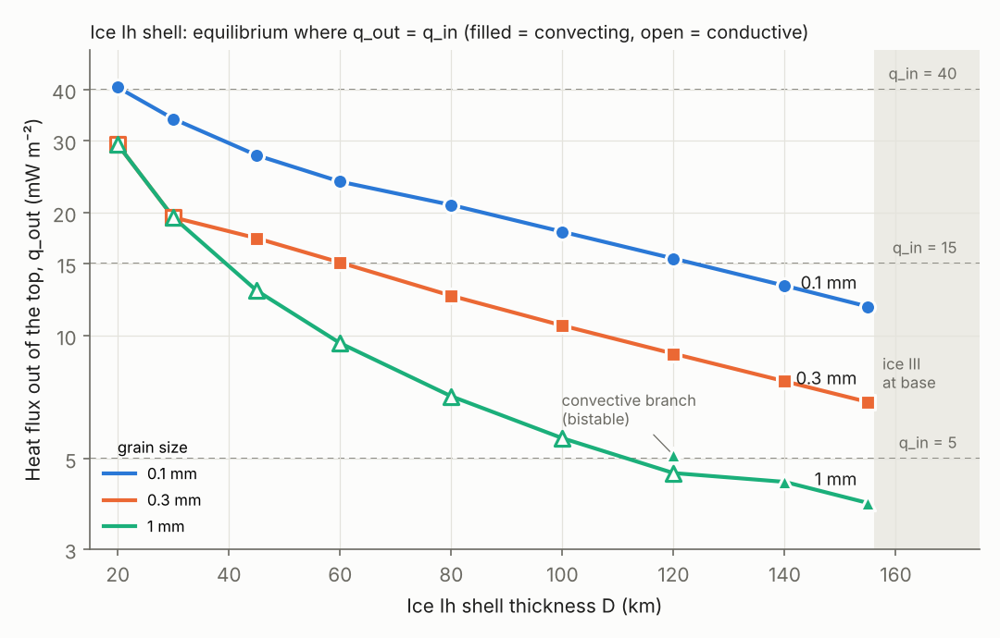
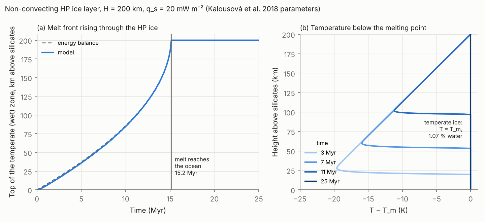
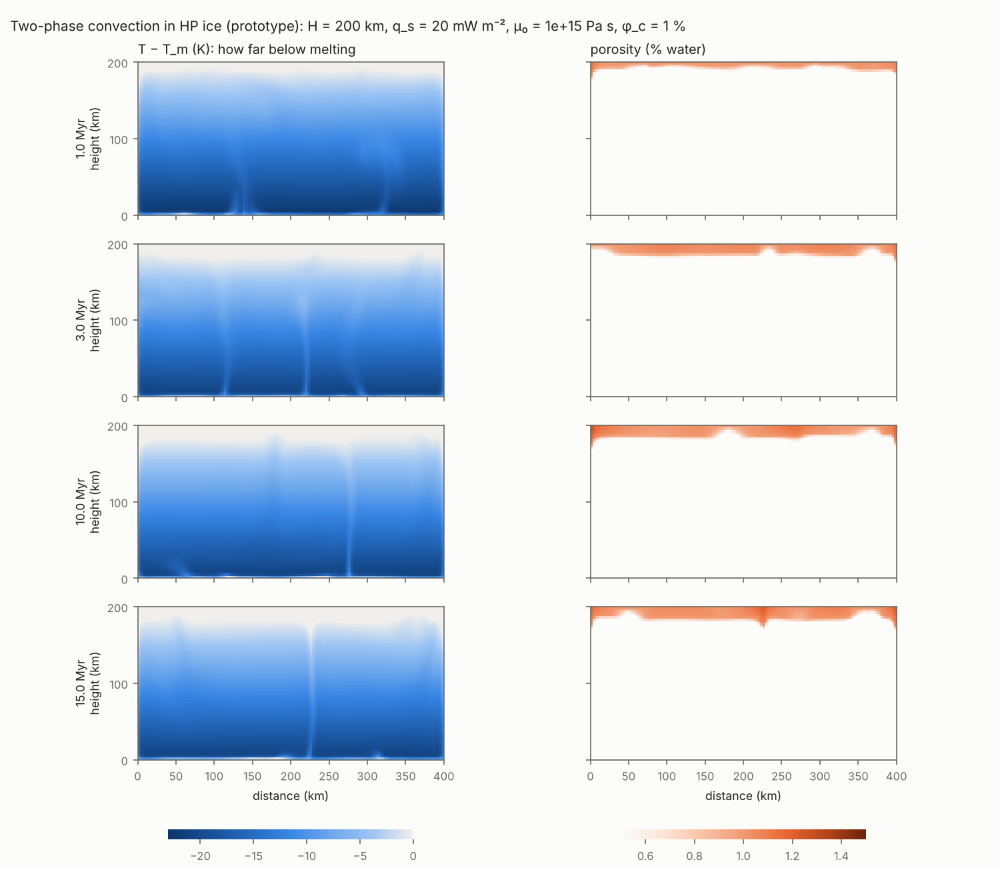
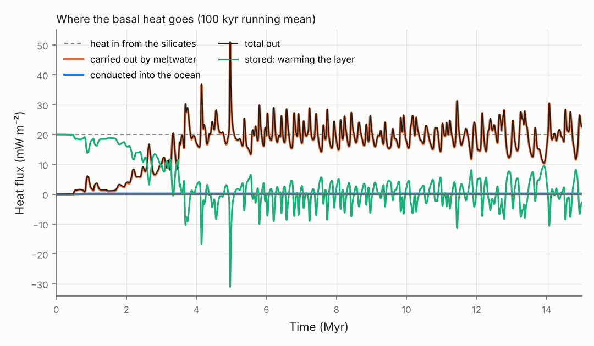
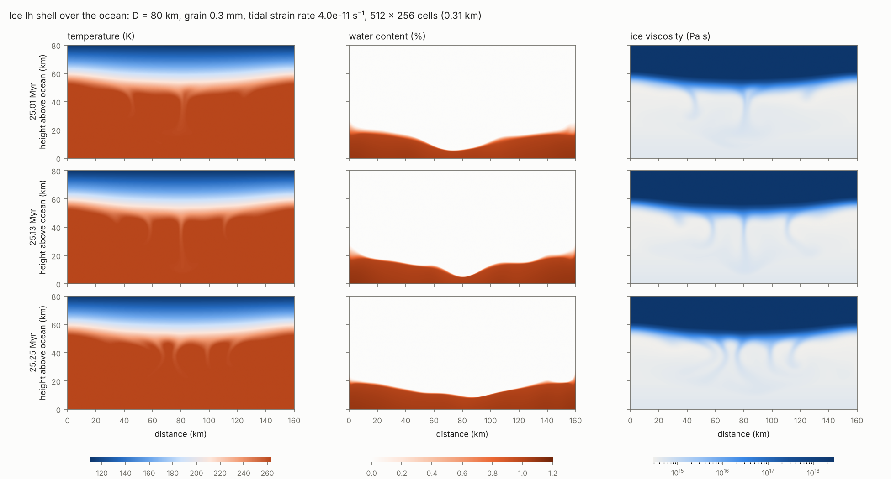
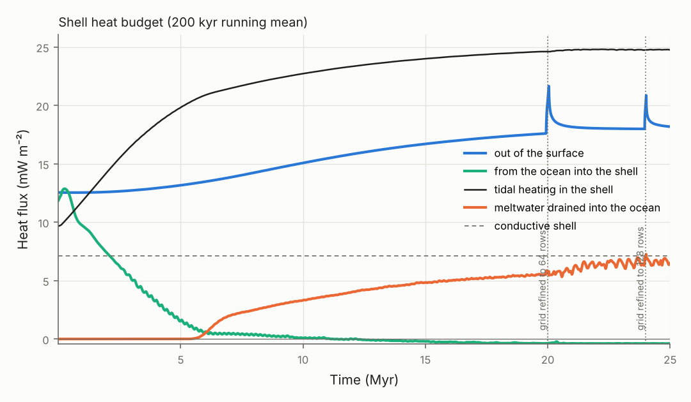
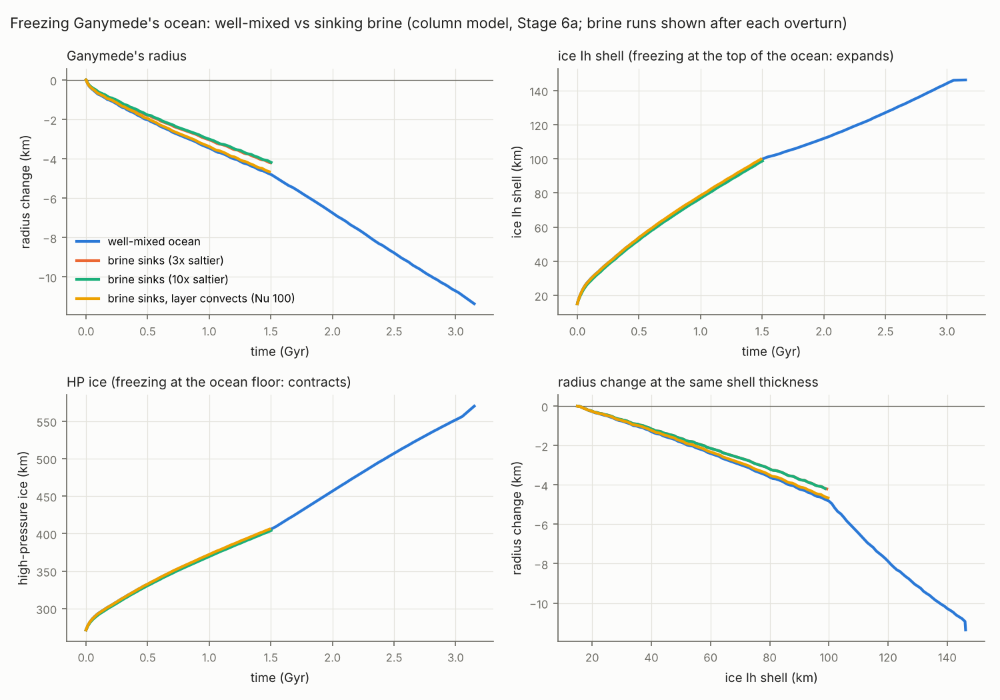

# ganymede-interior

A readable, tested interior-structure and convection model for **Ganymede**, written from scratch in Python. The aim is a code built around ice physics, not adapted from a silicate-mantle code, and growing step by step towards two-phase (ice–water) convection in the high-pressure ice layer.

> Work in progress. Each stage is checked against an analytic or published benchmark before the next one starts.

## Roadmap

| Stage | Content | Benchmark | Status |
|---|---|---|---|
| 0 | 1D structure: density, gravity, pressure, C/MR² fit | Uniform sphere (analytic) | ✅ |
| 0b | Self-consistent H₂O layer: SeaFreeze phases, conductive ice Ih shell, adiabatic ocean / HP ice | Closed-form k = a/T shell; M and C/MR² recovered | ✅ (PlanetProfile comparison pending) |
| 1 | 1D two-phase compaction (McKenzie equations) | Solitary porosity waves: second-order convergence, c = 2A + 1, mass conservation | ✅ |
| 2 | 2D Stokes convection on a staggered grid, T-dependent viscosity | Analytic Stokes flow (order 2, div v ≈ 0); Blankenbach et al. (1989) 1a and 2a within 0.05 % | ✅ |
| 2d | Real ice Ih: Arrhenius diffusion creep (capped), k = 651/T, equilibrium shell thickness | k(T) conduction analytic; cap-insensitivity; transient = steady; SeaFreeze melting curve | ✅ preliminary |
| 3a | Stokes on PETSc: symmetric saddle point, FGMRES + Schur field split | Analytic Stokes; mesh- and contrast-independent iterations (≤ 11 up to η contrast 10⁸) | ✅ |
| 3b | Native DMStag assembly + geometric multigrid on the velocity block | Matrix identical to SciPy assembly; 4 outer / 6 inner iterations from 32² to 512²; 10/5 at η contrast 10⁸ | ✅ |
| 3c | MPI-parallel runs (`scripts/parallel_stokes.py`) | 1, 2, 4 processes: same iterations, same solution (1e-13) | ✅ |
| 3d | 3D DMStag Stokes (MPI, geometric multigrid) | 3D analytic: order 2.0, div v ≈ 1e-15; 4 outer / 6 inner iterations; 3D = 2D when nothing varies in y (η contrast up to 10⁸); 1 vs 2 processes identical | ✅ |
| 3e | Convection on DMStag (2D): PETSc Stokes + energy, steady Picard, MPI | Identical to the SciPy code (ΔT ≈ 1e-10) for Blankenbach 1a and 2a; 1 vs 2 processes identical | ✅ (correct; not yet optimised) |
| 3f | 3D convection | Busse et al. (1994) 3D benchmark | ⬜ |
| 4a | Water percolation through ice, zero compaction length (Kalousová et al. 2018, Eq. 1c–d), 1D | Exact Riemann solutions (shock and rarefaction), converging with resolution; mass conserved to 1e-15 | ✅ |
| 4b | Temperate-ice energy: melting, freezing, T ≤ T_m (operator split), 1D | Heated half-space (analytic); total energy (sensible + latent) conserved to 1e-11 | ✅ |
| 4c | Non-convecting HP ice column: melt generation, percolation, refreezing | Melt-front arrival vs. energy balance (0.1 %); steady state q_s = conduction + latent heat of extracted water | ✅ |
| 4d′ | 2D two-phase convection prototype (incompressible matrix, upwind advection), Kalousová et al. (2018) setup | Energy conserved to 1e-10 over 19 Myr; top temperate layer 17–18 km vs. her 16 km; basal melting rule reproduces the 1D column; basal layer thinner than a cell | ✅ prototype |
| 4d | Two-phase convection in 2D: mixture Stokes with melt source and bulk-viscosity term, porosity advection, temperate energy | Reproduce Kalousová et al. (2018) reference run | ⬜ |
| 5 | Two-phase ice Ih shell over the ocean: meltwater sinks and drains into the ocean, IAPWS melting curve, k(T), Arrhenius creep, Maxwell tidal heating, ocean-side Stefan diagnostic | Conductive shell (analytic, 0.2 %); Stage 2d convective heat flow held to 0.4 %; tidal heating peaks at η = μ/ω; energy conserved to 1e-12 | ✅ first version |
| 6a | Salty hydrosphere evolution (column): ice Ih shell, two-layer ocean (well-mixed + sinking brine), HP ice; salt rejection at the mushy shell base, freezing-point depression, overturn of the brine layer; radius from mass balance | Liquidus vs SeaFreeze / Kalousová (0.5 K); seawater freezing point; mass to 1e-6; salt to 1e-16; energy to 1e-14 (well-mixed), 1e-2 (brine cycles) | ✅ first version |
| 7a | Stokes in a 2D annulus sector (polar staggered grid, arbitrary radial refinement, variable viscosity, free slip) | Manufactured solution with exact free-slip walls: 2nd order in v_r, v_θ, P on thick and 150 km annuli, uniform and refined grids; div v ≈ 1e-12 | ✅ |

## First results (pure-water H₂O layer, self-consistent with M and C/MR²)

| Surface heat flux | H₂O layer | Ice Ih shell | Ocean | HP ice | Phase sequence |
|---|---|---|---|---|---|
| 5 mW m⁻² | 809 km | 111 km | 224 km | 474 km | Ih → liquid → V → VI |
| 15 mW m⁻² | 802 km | 39 km | 455 km | 308 km | Ih → liquid → VI |
| 40 mW m⁻² | 799 km | 15 km | 537 km | 247 km | Ih → liquid → VI |

Gravity fixes the *total* H₂O thickness; the heat flux decides how it splits between ocean and high-pressure ice. Assumptions: conductive (non-convecting) Ih shell, adiabatic ocean and HP ice, no salts.

### Meltwater transport through high-pressure ice (Stage 1)

Porosity waves carry water upward in discrete pulses. For rough ice VI parameters (φ₀ = 1 %, Δρ ≈ 120 kg m⁻³), a wave crosses 300 km of HP ice in ~10³–10⁷ yr depending on grain size (10–0.1 mm). The crossing time depends on permeability only, **not** on ice viscosity, which sets the wave width (compaction length ~10 m – 10 km).

### Convection benchmarks (Stage 2)

| Blankenbach et al. (1989) | Nu (this code) | Nu (reference) | v_rms (this code) | v_rms (reference) |
|---|---|---|---|---|
| 1a: Ra = 10⁴, constant η | 4.8846 | 4.8844 | 42.865 | 42.865 |
| 2a: Ra = 10⁴, η contrast 10³ | 10.061 | 10.066 | 480.63 | 480.43 |

Richardson-extrapolated from 64² and 128² grids.

### Ice Ih shell: how thick is it? (Stage 2d, preliminary)

For each shell thickness D the base sits at the ice Ih melting point at the base pressure (SeaFreeze), the surface at 110 K; viscosity is Arrhenius diffusion creep, k = 651/T, steady 2D convection at 64², aspect 1. The shell is in equilibrium where the heat leaving the top, q_out(D), equals the heat arriving from below, q_in. Ice Ih cannot float deeper than ≈ 156 km: below that the base would be ice III.



Equilibrium thickness (km):

| q_in (mW m⁻²) | 0.1 mm grains | 0.3 mm grains | 1 mm grains |
|---|---|---|---|
| 5 | ≥ 156 (Ih–III limit) | ≥ 156 (Ih–III limit) | 112–123 (bistable)* |
| 10 | ≥ 156 (Ih–III limit) | 107 | 58 (cond.) |
| 15 | 124 | 61 | 39 (cond.) |
| 20 | 86 | 29 (cond.) | 29 (cond.) |
| 30 | 39 | 20 (cond.) | 20 (cond.) |
| 40 | 21 | 15 (cond.) | 15 (cond.) |

\* Around 110–125 km the 1 mm shell has two stable steady states (conductive and weakly convecting, Nu ≈ 1.1); which one it is in depends on its history.

Reading: grain size matters more than heat flux. Fine-grained (0.1 mm) ice convects efficiently, so the shell must grow thick (≈ 90–125 km at 15–20 mW m⁻²) before it loses only what it receives, and at ≤ 10 mW m⁻² it reaches the Ih–III limit. Coarse-grained (1 mm) ice barely convects, and the shell settles at a few tens of km.

Caveats (why "preliminary"): ρ, g, α held fixed through the shell; diffusion creep only (no grain-boundary sliding or dislocation creep); pure water (no salts or NH₃, which lower T_b); no tidal heating; steady states only; 64² grid. Box width checked once: for 0.1 mm grains at 120 km, a box twice as wide (128 × 64, time-dependent run started from the convective state) keeps q_out = 15.45 mW m⁻², identical to aspect 1. Reproduce with `python scripts/shell_equilibrium.py run --grain 0.1` (one grain size, ~20 min) and `python scripts/shell_equilibrium.py plot results/shell_equilibrium.json`.

### Melt in the high-pressure ice layer, without convection (Stage 4c)

The zero-compaction-length model of Kalousová et al. (2018) in a 1D column: 200 km of ice VI, starting at the ocean-interface melting point and heated from below at 20 mW m⁻². The heat from the silicates melts the base, the water rises and refreezes in the colder ice above, and that latent heat warms the ice until a temperate (partially molten) channel reaches the ocean.



- The melt reaches the ocean after **15.2 Myr**, exactly as an energy balance predicts (warming the ice up to the melting curve takes almost all of it).
- After that, 99 % of the basal heat (19.8 of 20 mW m⁻²) leaves as meltwater, ≈ 1.4 mm/yr ≈ 1.4 km of water per Myr; only 0.18 mW m⁻² is conducted along the melting curve.
- The temperate ice holds just 1.07 % water, barely above the 1 % percolation threshold: the permeability law, not the heat flux, fixes how wet it is.

This is the no-convection end-member, a test bed for the two-phase pieces. With μ₀ = 10¹⁵ Pa s the layer convects vigorously, which is Stage 4d. Reproduce with `python scripts/hp_column.py`.

### Two-phase convection in the high-pressure ice layer (Stage 4d, prototype)

Kalousová et al. (2018) reference setup in 2D: 200 km of ice VI (aspect 2), 20 mW m⁻² from the silicates, μ₀ = 10¹⁵ Pa s, percolation threshold 1 %, starting at the ocean-interface melting point. Hot plumes rise from the silicate interface; where ice reaches its melting point it melts, the water percolates up and leaves into the ocean, and water that meets colder ice refreezes. 64 × 128 cells (3 km), 19 Myr; the basal melting rule (below) switched on at 15 Myr.





| | This model | Kalousová et al. (2018), run 1 |
|---|---|---|
| Statistical steady state reached | ~4 Myr (mean T 311.0–311.2 K from then on) | ~10 Myr |
| Heat leaving as meltwater | 98–99 % of q_s; conduction 0.18 mW m⁻² | "the majority" (conduction ~2 orders of magnitude smaller) |
| Top temperate layer | 16.5–18 km, ~0.9 % water | ~16 km, φ_av ~1 % |
| Interior | ~10 K below the melting point; melt only in plume heads | "well below the melting point"; melt in some plume heads |
| Melting at the silicate interface | ~half the basal heat (10.6 of 20 mW m⁻²) melts ice at the interface; the water refreezes within the first 3 km cell, so the layer is thinner than one cell | thin temperate layer, T_av = T_m, φ ≲ 1 % |

- First melt reaches the ocean after ~0.5 Myr, and after ~4 Myr essentially all the basal heat leaves as meltwater, in bursts as plume heads arrive.
- In a conductive layer (Stage 4c) the same heat takes 15 Myr to open a path to the ocean; convection does it ~30 times faster.
- Basal melting rule: the silicate interface cannot be hotter than its melting point. Where the fixed heat flux would push it above, the interface is held at T_m and the heat the ice cannot conduct away melts ice there (found column by column with an active-set loop; exact energy conservation kept). Without it, the 3 km bottom cell hid an interface ~20 K above melting. With convection switched off, the 2D model with this rule reproduces the 1D column (melt reaches the ocean at 14.97 vs. 15.14 Myr).

Prototype limitations (Stage 4d proper removes them): the ice matrix is incompressible (no volume change on melting, no bulk-viscosity term); first-order upwind advection; 3 km cells (bottom boundary layer barely resolved). The Stokes solve uses the PETSc DMStag multigrid solver (no-slip bottom added): 0.2 s at 64 × 128, 1.1 s at 128 × 256, 6.2 s at 256 × 512, matching the direct solver to 4e-7. Reproduce with `python scripts/hp_convection.py run --t_end 15` then `python scripts/hp_convection.py plot results/hp_convection_ref.pkl --times 1 3 10 19 --phimax 1.5` (continue a run with `--restart`; add `--snap_every 0.1` for animation frames). To look at a run in ParaView: `python scripts/to_paraview.py results/<run>.pkl`, then open `paraview/<run>/run.pvd`.

### Two-phase ice Ih shell over the ocean (Stage 5, first results)

The shell itself as a two-phase layer: an 80 km ice Ih shell (0.3 mm grains, 160 km wide) between a 110 K surface and the ocean, whose interface sits at the ice Ih melting point (IAPWS melting curve). Liquid water is denser than ice Ih, so meltwater sinks: it percolates down and drains into the ocean. Tidal heating follows a Maxwell body (Tobie et al. 2003) with strain-rate amplitude 4 × 10⁻¹¹ s⁻¹, roughly a past high-eccentricity period (e ~ 0.02); present-day Ganymede (~2 × 10⁻¹² s⁻¹) has negligible tidal heating. Spun up for 20 Myr at 2.5 km, then 4 Myr at 1.25 km, 1 Myr at 0.62 km, and the last 0.25 Myr at 0.31 km (512 × 256 cells).





- Tidal heating (24.8 mW m⁻²) is concentrated in the warm convecting ice beneath a ~25 km stagnant lid. The ice there is pushed to its melting point and a partially molten layer with ~1 % water forms in the lower 5–23 km of the shell (thinnest under the cold downwelling).
- 6.6 mW m⁻² of that heat (27 %) leaves as meltwater draining into the ocean, ≈ 0.6 mm/yr of water; 18.3 mW m⁻² leaves through the surface (Nu ≈ 2.6). The ocean can deliver almost no heat into the shell (−0.4 mW m⁻²: heat actually flows down along the melting curve into the ocean).
- Consequence: the shell is losing ice to the ocean at ~0.6 km/Myr from internal melting, plus whatever heat the ocean supplies to its base. An 80 km shell is not in equilibrium under this tidal heating; it would thin until tidal heating and heat loss balance. That needs the moving base (next step).

Resolution check (time averages over the last part of each stage):

| Cell size | Surface heat flow | Meltwater to the ocean | Partially molten fraction | Wet layer thickness |
|---|---|---|---|---|
| 1.25 km | 18.0 mW m⁻² | 6.2 mW m⁻² | 19.5 % | — |
| 0.62 km | 18.3 mW m⁻² | 6.6 mW m⁻² | 18.9 % | 14.2 km |
| 0.31 km | 18.5 mW m⁻² | 7.2 mW m⁻² | 19.4 % | 14.5 km |

The bulk numbers change by a few percent; finer grids mainly sharpen plume tails, cold drips and the melt front. At 0.31 km a step takes ~3.5 s (warm-started multigrid Stokes, 6 iterations; BiCGSTAB energy solve), i.e. ~4.5 h per Myr on one core; `mpiexec -n 4 python scripts/shell_run.py run ...` splits the Stokes solve between processes (same result to ~1e-7).

Benchmarks: without tidal heating a conductive shell matches the analytic k = a/T solution (0.2 %), and started from the Stage 2d steady state the surface heat flow stays within 0.4 % of Stage 2d. Simplifications: as Stage 4d′ (incompressible matrix, upwind advection), plus constant heat capacity, no melt softening, fixed shell thickness, no salts. Reproduce with `python scripts/shell_run.py run --D 80 --grain 0.3 --edot 4e-11 --nz 32 --t_end 20 --out results/shell.pkl`, then `--restart ... --refine 2` twice (see the script header); ParaView via `python scripts/to_paraview.py results/shell_hr.pkl` (fields include temperature, water content, viscosity, tidal heating and velocity).

### Does a freezing ocean make Ganymede grow? (Stage 6a)

Hypothesis tested: water exchange between the shell and the ocean (purer ice freezes onto the shell, rejected brine sinks) thickens the shell over Gyr, and the volume increase of freezing (ice Ih is lighter than water) expands Ganymede, driving the extension that formed the bright terrain. The catch is the other end of the ocean: high-pressure ice (V, VI) is *denser* than water, and a cooling ocean freezes there too.

Column model of the whole hydrosphere (fixed rock and H₂O + salt mass, radius from the mass balance; SeaFreeze EoS with the liquidus resolved to 0.01 K; NaCl-like salt with ideal freezing-point depression; heat loss through the shell from the Stage 2d convection results; rock heat flux decaying from 30 mW m⁻² with a 2 Gyr e-folding time). Sinking brine forms a stratified layer on the ocean floor that only conducts heat; the floor then has its own heat balance. The layer overturns when it is no longer saltier than the ocean above.



| Case | Shell | HP ice | Radius change | Areal strain |
|---|---|---|---|---|
| well-mixed, 10 g/kg, 3.15 Gyr | 15 → 146 km | 271 → 570 km | −11.4 km | −0.87 % |
| well-mixed, 50 g/kg, 2.9 Gyr | 15 → 133 km | 283 → 534 km | −8.6 km | −0.66 % |
| well-mixed, 100 g/kg, 1.8 Gyr (eutectic) | 15 → 99 km | 297 → 435 km | −3.4 km | −0.26 % |
| brine sinks (3× saltier), 1.5 Gyr | 15 → 101 km | 271 → 402 km | −3.8 km | −0.29 % |
| brine sinks (10× saltier), 1.5 Gyr | 15 → 99 km | 271 → 404 km | −4.2 km | −0.32 % |
| brine sinks, layer convects (Nu 100), 1.5 Gyr | 15 → 99 km | 271 → 409 km | −4.9 km | −0.37 % |
| brine sinks, 1 % of salt kept in ice, 1.5 Gyr | 15 → 100 km | 271 → 401 km | −4.3 km | −0.33 % |

- In every case Ganymede **contracts** as its ocean freezes: the HP-ice floor grows two to three times as much as the ice Ih shell, and per kilogram the two volume changes are similar and opposite.
- Sinking brine does what the hypothesis needs locally: it insulates and dissolves the HP-ice floor. But the rock heat that dissolves the floor also dilutes the brine layer with meltwater, and it overturns every few Myr. Averaged over these cycles the effect is small (≤ 1 km over 1.5 Gyr).
- This matches the published view that refreezing an internal ocean causes little net area change (Squyres 1980; Showman et al. 1997; Bland et al. 2009).

Not in this model, and possible ways out: an early Ganymede with no HP ice yet (or HP ice melted during a resonance passage, Bland et al. 2009); MgSO₄ instead of NaCl (different phase behaviour, e.g. Vance et al. 2014); local rather than global extension, from stresses in a thickening shell and pressurisation of the ocean beneath it. Reproduce with `python scripts/hydro_evolution.py run <label> --f_sink 1 --out results/<file>.json` and `python scripts/hydro_evolution.py plot results/hydro_*.json`.

## Install

```bash
pip install -e ".[dev,eos]"
conda install -c conda-forge petsc petsc4py mpi4py   # for Stage 3
pytest              # fast tests (~25 s)
pytest -m slow      # 128² Blankenbach 2a run and the 200 km HP column (~1 min)
```

## Layout

```
src/ganymede/   model code
tests/          benchmarks as unit tests
notebooks/      one notebook per stage, worked through cell by cell
```

## License

MIT
